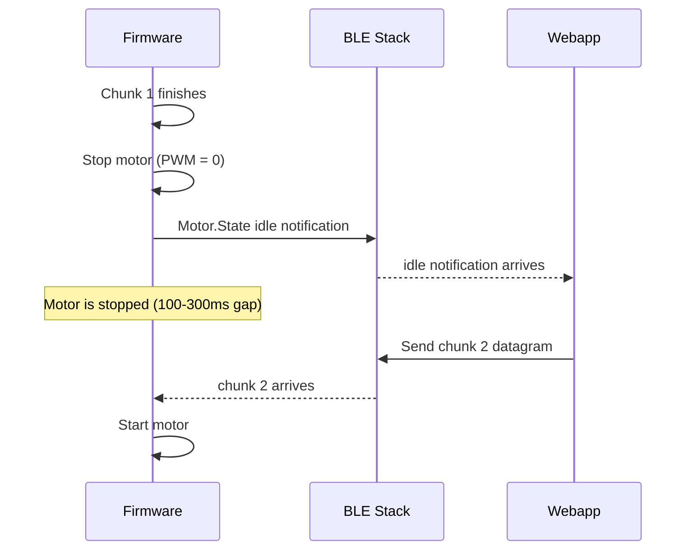
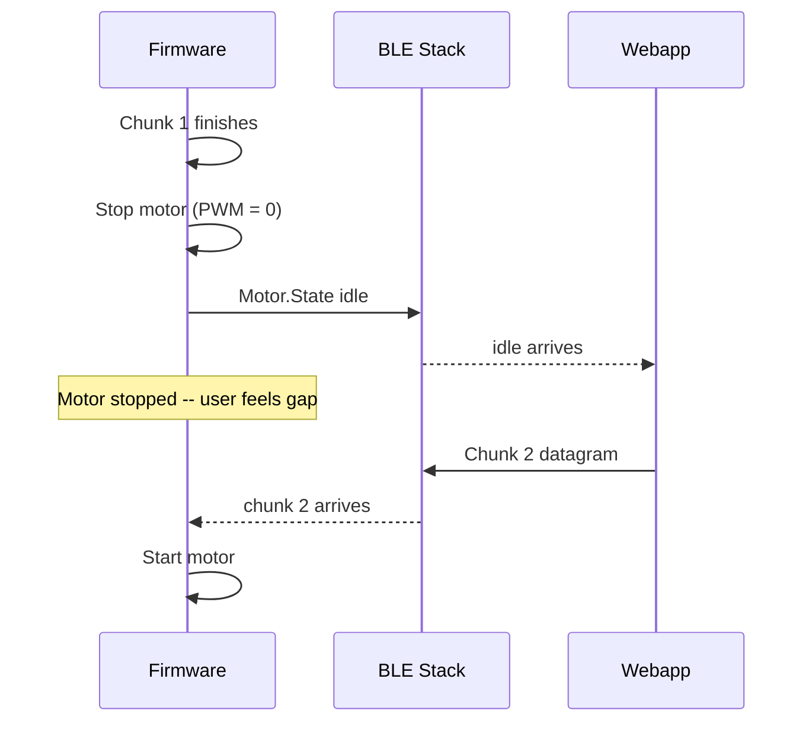
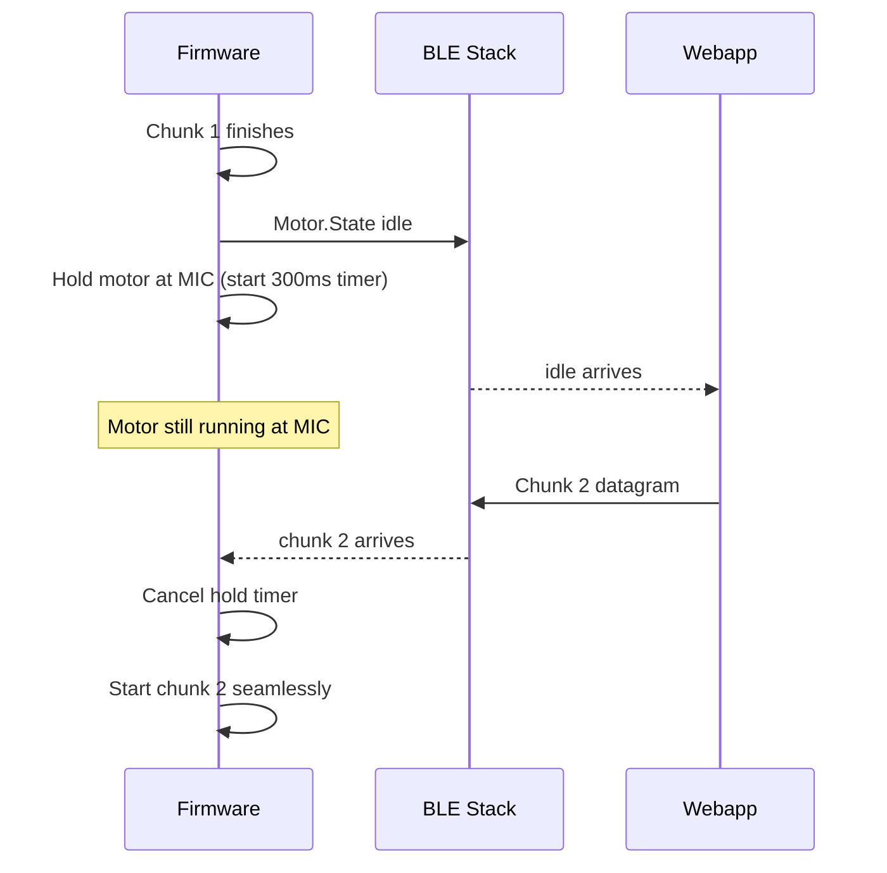
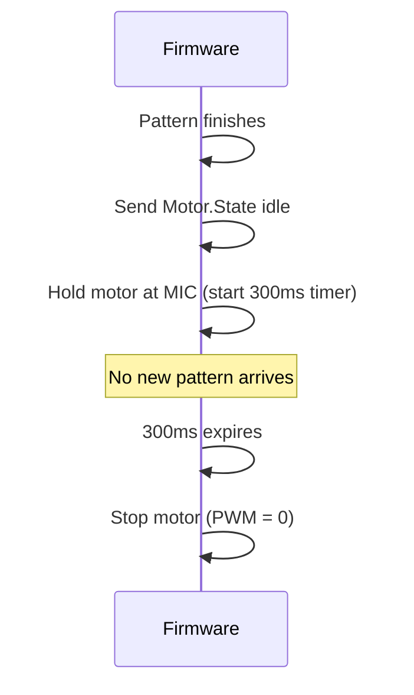

# Firmware Request: Motor Hold After NonRepeatingPattern

## The Problem

The PB-03 BLE module limits ATT payload to 121 bytes, which fits a maximum of 28 linear segments per datagram. When users create patterns with more than 28 segments, the webapp splits them into multiple datagrams and sends them one at a time as NonRepeatingPattern.

The webapp waits for the Motor.State idle notification before sending the next chunk. This works correctly, but the motor physically stops during the round-trip:

The total gap is 100-300ms (measured by the webapp and logged as `SYNC` entries in BLE Traffic). During this entire window the motor is stopped, which the user can clearly feel as a pause between chunks.

## The Solution

After a NonRepeatingPattern with **Pattern ID in the range 100–199** finishes playing, **keep the motor running at the last known MIC value as a flat (constant) output for 300ms** instead of immediately stopping.

Pattern IDs 100–199 are reserved for multi-datagram chunk sequencing. Pattern IDs outside this range (0–99, 200–255) should behave as before — stop the motor immediately when the pattern completes.

### Detailed Behavior

1. NonRepeatingPattern with patternId 100–199 finishes its last segment normally
2. Instead of setting PWM to 0 and going idle:
   - Keep PWM at the last MIC intensity value (the MIC byte from the datagram header, byte 4 of the motor payload)
   - Start a 300ms hold timer
   - Send the Motor.State idle notification immediately (so the webapp can send the next chunk as fast as possible)
3. During the 300ms hold:
   - **If a new pattern write arrives** (RepeatingPattern or NonRepeatingPattern): cancel the hold timer, seamlessly transition to the new pattern. The motor never stopped, so the user feels no gap.
   - **If the 300ms expires with no new pattern**: stop the motor (PWM = 0). This is the normal end-of-playback case for single-datagram patterns or the final chunk of a multi-datagram sequence.

### Why 300ms

The webapp measures the actual gap between sending chunk N's idle and receiving chunk N+1's running confirmation. Current measurements show 100-300ms depending on BLE connection parameters. 300ms provides a safe margin. If future measurements show different values, this can be adjusted.

### Why This Works

- **Multi-datagram sequences**: The next chunk always arrives within 100-300ms, well within the hold window. The motor never stops between chunks.
- **Single-datagram patterns**: The 300ms hold adds a brief tail at the end, but at the MIC intensity the user chose, so it feels natural rather than abrupt.
- **Looping multi-datagram**: Same as multi-datagram -- the loop restart chunk arrives during the hold.
- **User presses Stop**: The webapp sends a Control.Reset (0x00 0x00), which should cancel the hold timer and stop the motor immediately.

### What the Motor.State Notification Timing Looks Like

#### Before (current) -- motor stops between chunks

#### After (with hold) -- seamless multi-datagram transition

#### After (with hold) -- single pattern or final chunk

### Summary of Changes

| Condition | Current Behavior | New Behavior |
|-----------|-----------------|--------------|
| NonRepeatingPattern (ID 100-199) finishes | Stop motor, send idle | Send idle, hold motor at MIC for 300ms |
| NonRepeatingPattern (ID 0-99) finishes | Stop motor, send idle | Stop motor, send idle (unchanged) |
| New pattern arrives during hold | N/A | Cancel hold, start new pattern seamlessly |
| Hold timer expires | N/A | Stop motor (PWM = 0) |
| Control.Reset received during hold | N/A | Cancel hold, stop motor immediately |
| RepeatingPattern finishes cycle | Restart (unchanged) | Restart (unchanged -- no hold needed) |

### No Changes Needed To

- Motor.State notification format or content
- Datagram parsing
- RepeatingPattern behavior
- BLE characteristic configuration
- Any other protocol messages

---

## Email Draft

The PB-03's factory firmware limits BLE payload to 121 bytes per write. With the 2-byte datagram header and 5-byte motor header, that leaves room for only 28 linear segments per datagram. I've updated the Vibe protocol to work within this 121-byte limit rather than trying to change the PB-03's MTU settings.

For patterns longer than 28 segments, the webapp now splits them into multiple datagrams and sends them sequentially -- it waits for the device to report "idle" after each chunk, then sends the next one. This works, but the motor stops for 100-300ms between chunks while the BLE round-trip happens, and the user can feel that pause.

The fix is a small firmware change: after a NonRepeatingPattern finishes, keep the motor running at the last MIC value for 300ms instead of stopping immediately. If the next chunk arrives during that window (which it always does), start it seamlessly. If nothing arrives, stop normally. That way multi-datagram patterns play without any perceptible gap.

See the detailed spec above, including sequence diagrams and a summary table of the exact behavior changes needed.
